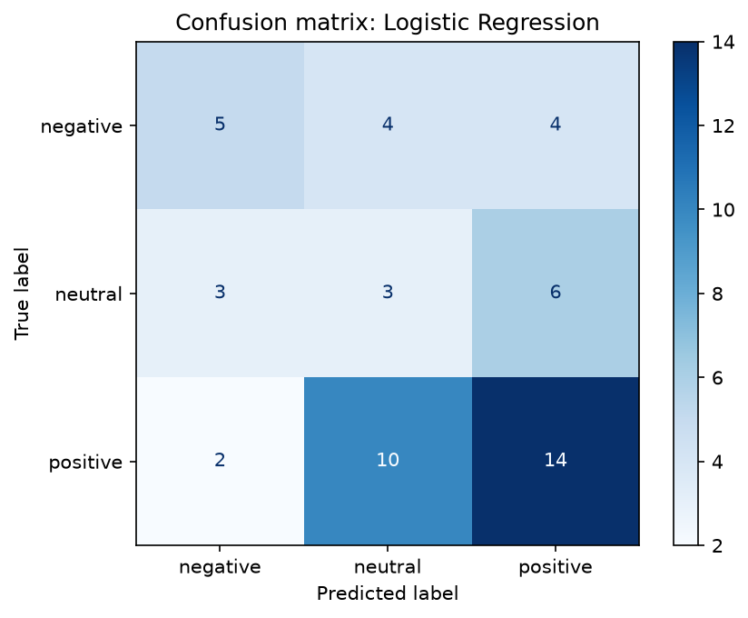
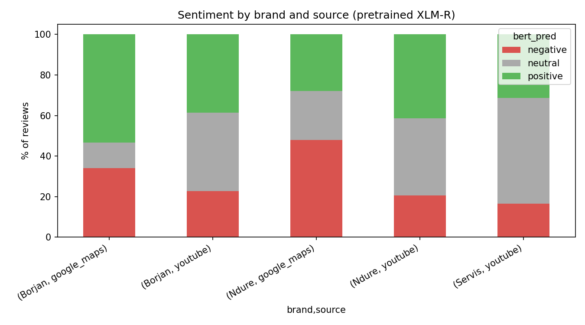
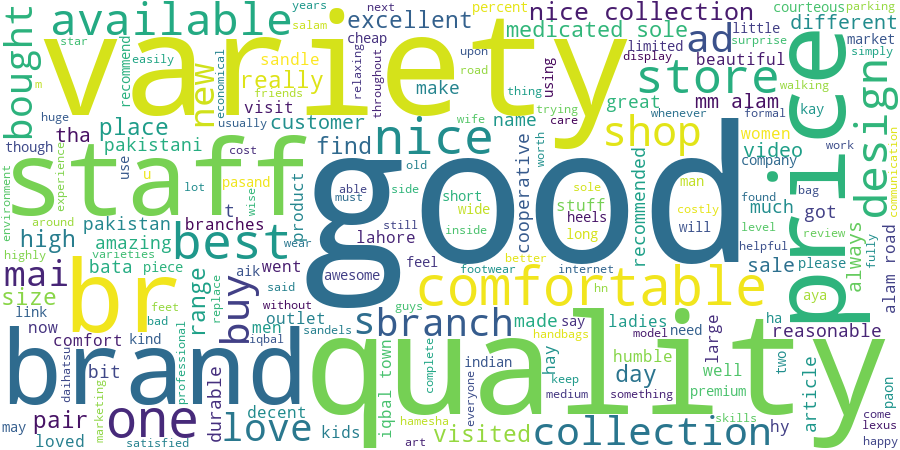
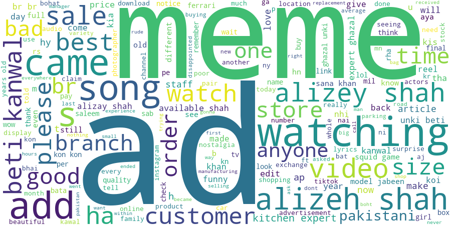

# Pakistani Footwear Brand Sentiment Analysis

Big data sentiment analysis of three Pakistani footwear brands (**Borjan, Servis, Ndure**) on multilingual (English / Roman Urdu / Urdu) YouTube comments and Google Maps reviews. Built for a Big Data course project.

## Pipeline

1. **Collect:** YouTube Data API v3 (comments) + Google Maps outlet reviews (Outscraper export)
2. **Standardise:** all sources merged into one schema: `brand, source, review_id, text, rating, date, product_or_outlet`
3. **Clean:** lowercase, strip URLs and punctuation, detect language (English / Roman Urdu / Urdu script)
4. **Label:** Google Maps stars → negative (1-2), neutral (3), positive (4-5)
5. **Model:** TF-IDF character n-grams + Logistic Regression / Naive Bayes, versus a pretrained multilingual transformer (XLM-R)
6. **Scale test:** PySpark vs pandas benchmark on replicated data

## Data

| Brand | YouTube comments | Google Maps reviews |
|---|---|---|
| Servis | 576 | none |
| Ndure | 58 | 100 |
| Borjan | 44 | 103 |

Counts are after cleaning (881 rows in total). Only 203 Maps reviews have both a star rating and written text, so those are the labeled rows used for training and evaluation.

## Results

| Model | Accuracy | Macro F1 | Evaluated on |
|---|---|---|---|
| Naive Bayes (TF-IDF) | 0.51 | 0.23 | 51 held-out rows (predicts mostly "positive") |
| Logistic Regression (TF-IDF) | 0.43 | 0.40 | 51 held-out rows |
| Pretrained XLM-R (no fine-tuning) | 0.55 | 0.49 | all 203 labeled rows |



The pretrained model beats the models trained on this small dataset. The neutral class is the weakest (F1 about 0.2), partly because 3-star reviews are ambiguous.

### Brand comparison (XLM-R predictions)



- On Google Maps, Borjan looks more positive than Ndure (about 53% vs 28% positive).
- YouTube comments are mostly neutral, because most are short reactions rather than opinions about the shoes.




### Spark vs pandas

Benchmark on the dataset replicated many times (this measures scalability; it is not new data):

| Rows | pandas (s) | Spark (s) |
|---|---|---|
| 881 | 0.03 | 0.66 |
| 88,100 | 0.48 | 1.50 |
| 881,000 | 4.59 | 4.60 |
| 3,524,000 | 16.54 | 14.93 |

Spark's startup cost makes it slower on small data. They break even around 1M rows, and Spark is slightly ahead at 3.5M (run on Colab's free 2-core machine).

## Limitations

- **Small labeled set** (203 rows), so scores are noisy and the test split is tiny.
- **Servis has no Google Maps data**, so its sentiment comes only from YouTube comments. These have no star labels and the numbers cannot be verified.
- Maps data covers only a few outlets per brand (for example Borjan M M Alam Road and Ndure Lahore), so it is not a sample of the whole brand.
- Roman Urdu detection is a simple word-list heuristic, so some Roman Urdu is counted as English.
- Model predictions on YouTube are unverified, because the models learned from store reviews, which read differently from video comments.

## Next steps

- Hand-label about 100 Servis comments as a proper test set
- Add more outlets and sources
- Fine-tune a multilingual model on the labeled data
- Aspect analysis (comfort, sizing, durability, price) and a Streamlit dashboard

## Run it

```bash
pip install -r requirements.txt
cp .env.example .env        # add your YOUTUBE_API_KEY
python src/scraping/scrape_youtube.py
python src/processing/load_maps.py
python src/models/train_and_report.py
```

The transformer and Spark steps are in `notebooks/Brand_Sentiment_Colab.ipynb` (run on Google Colab).